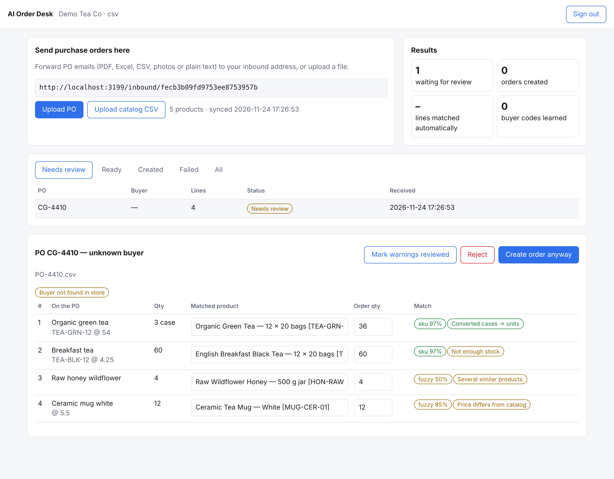

# AI Order Desk

Turns wholesale purchase orders that arrive by email — PDF, Excel, CSV, photos or plain text — into draft orders, with every line matched to the right SKU. The merchant reviews and approves with one click.

Shopify is the first platform. The core is platform-neutral: adding WooCommerce, BigCommerce, QuickBooks or Xero means writing **one connector file** (see `src/connectors/index.js`).

> 🇧🇩 ব্যবসায়িক প্ল্যান ও যাচাই কিট: [`../docs/AI_ORDER_DESK_PLAN_BN.md`](../docs/AI_ORDER_DESK_PLAN_BN.md)



## How it works

```
email / upload ─► extract ─► find buyer ─► match lines ─► review ─► approve ─► connector.createOrder()
                  (table      (connector)   memory → SKU →  (UI)                (Shopify draft order,
                   or AI)                   barcode → fuzzy                      CSV export, …)
```

| Step | File | Notes |
|---|---|---|
| Inbound email | `src/core/pipeline.js` `ingestEmail` | `POST /inbound/<token>` with the raw message (forwarding rule, Postmark/Mailgun/SES inbound). Skips logo/signature images. |
| Extraction | `src/core/extract.js`, `src/core/ai.js` | CSV/XLSX with recognizable headers are parsed exactly with no AI cost. PDFs, images, email text and odd sheets go to Claude with a strict JSON schema. AI output is validated and clamped. |
| Matching | `src/core/match.js` | Buyer memory (per company domain) → exact SKU → barcode → fuzzy text. Converts cases/dozens to units using `case_pack`, flags price differences, low stock, ambiguous names. Fuzzy matches never auto-approve. |
| Learning | `remember()` | Every correction and every approved order teaches "buyer X's code Y = item Z". The second PO from a buyer usually matches fully. |
| Safety | `pipeline.js` | Duplicate PO numbers, prompt-injection text, empty catalog and unknown buyers hold the PO for review. Approve is idempotent (no double orders). |
| Connectors | `src/connectors/` | `shopify.js` (Admin GraphQL: variants, customers with B2B company/location, `draftOrderCreate`), `csv.js` (no platform: catalog upload + CSV export). |

Statuses: `needs_review` → `ready` → `created`, or `rejected` / `failed` (retryable).

## Run locally

```bash
cd order-desk
npm install
npm test                       # 21 tests, no network needed (AI and Shopify are faked)

# a store without Shopify (catalog via CSV)
npm run create-store -- --name "Demo Tea Co" --platform csv
# or a Shopify store via a custom-app admin token
npm run create-store -- --name "Acme" --platform shopify --shop acme.myshopify.com --token shpat_...

ANTHROPIC_API_KEY=sk-ant-... npm start   # http://localhost:3100, sign in with the printed API key
```

## Environment

| Variable | Purpose |
|---|---|
| `ANTHROPIC_API_KEY` | Reads PDFs, images and free-text orders (spreadsheets work without it) |
| `AI_MODEL`, `AI_EFFORT` | Default `claude-opus-5-5`, `low` |
| `ENCRYPTION_KEY` | 64 hex chars; encrypts platform tokens (required in production) |
| `SESSION_SECRET` | Signs session cookies (required in production) |
| `APP_URL`, `PORT`, `DB_PATH` | Public URL (used for OAuth redirect and inbound address), port, SQLite path |
| `SHOPIFY_API_KEY`, `SHOPIFY_API_SECRET` | Public Shopify app credentials (OAuth install + webhooks) |
| `SHOPIFY_API_VERSION`, `SHOPIFY_SCOPES` | Default `2026-10`; `read_products,read_inventory,read_customers,write_draft_orders,read_companies` |
| `AUTO_MATCH_CONFIDENCE` | Lines at or above this need no review (default 0.9) |

## Shopify app setup

1. Create an app in the Shopify Partner dashboard. App URL: `APP_URL/`, redirect URL: `APP_URL/shopify/callback`.
2. Compliance webhooks (`customers/data_request`, `customers/redact`, `shop/redact`) and `app/uninstalled` → `APP_URL/shopify/webhooks`.
3. Install from `APP_URL/shopify/install?shop=<shop>.myshopify.com`. The catalog syncs automatically after install.

## Adding a platform

Implement `fetchCatalog`, `findCustomer` and `createOrder` (contract in `src/connectors/index.js`) and register it. The test `a new platform only needs a connector` in `test/shopify.test.js` shows a complete WooCommerce-style example in 10 lines.

## Not built yet (next steps)

- Embedded Shopify admin UI (App Bridge session tokens) and Shopify Billing API — currently a standalone page with cookie/API-key sign-in
- IMAP mailbox polling (reuse `../src/services/mail.js` from MailPilot) as an alternative to forwarding
- Confirmation email back to the buyer; Slack/email alert for POs waiting for review
- Per-company B2B catalog prices (Shopify Plus) instead of the variant price for mismatch checks
- WooCommerce, QuickBooks/Xero connectors; rate limiting; background job queue for very large POs
